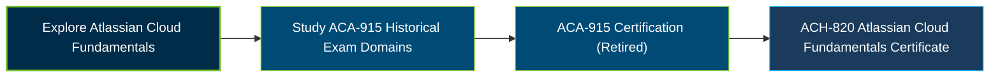

# Atlassian Cloud Foundations (ACA-915) Certification Exam Guide

A dedicated study guide and knowledge reference for the **Atlassian Cloud Foundations (ACA-915) Certification Exam**, covering Atlassian Cloud applications, integrations, subscriptions, user management, and ecosystem support. This repository preserves the historical exam topics; ACA-915 was retired in August 2026.

---

## Exam Overview

The Atlassian Cloud Foundations certification validated foundational knowledge of Atlassian Cloud products, their use cases, integrations, subscription models, user management, and support resources. The credential was intended for professionals working with or exploring the Atlassian Cloud ecosystem.

- **Exam Format**: Proctored certification exam; ACA-915 is retired and unavailable for new exam bookings.
- **Target Audience**: Atlassian Cloud users, IT professionals, solution partners, administrators, and teams evaluating Atlassian products.
- **Prerequisites**: No formal prerequisite identified in the available Atlassian certification information.

---

## Core Exam Domains & Knowledge Areas

### 1. Atlassian Cloud Apps and Integrations

- Understand Atlassian Cloud applications, their purposes, and common use cases.
- Identify how Jira, Confluence, Jira Service Management, and other Atlassian products support different teams.
- Understand product integrations and how applications work together across the Atlassian ecosystem.

### 2. Atlassian Cloud Subscriptions and User Management

- Understand Atlassian Cloud subscription models, plans, and user tiers.
- Review user access, licensing, and account-management concepts.
- Understand how subscription choices relate to product access and team requirements.

### 3. Atlassian Cloud Community and Support

- Identify Atlassian support channels and available assistance resources.
- Navigate Atlassian Community and knowledge-sharing resources.
- Understand where to find product documentation, learning materials, and guidance.

---

## Certification Path

---

## Recommended Practice & Study Resources

The following resources support learning about Atlassian Cloud applications, subscriptions, user access, and the broader product ecosystem.

- **CertsGate**: Explore available [ACA-915 Cloud Foundations preparation resources](https://certsgate.com/exams/atlassian/aca-915) for additional study and knowledge review.
- **Atlassian Cloud Products**: Use the [official Atlassian product and cloud resources](https://www.atlassian.com/try) to explore product capabilities, use cases, and integrations.

